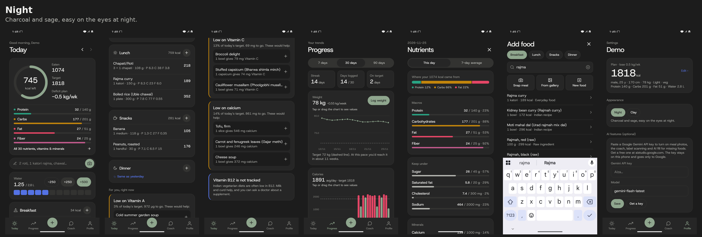

# Caltrack

An offline calorie and nutrition tracker for Indian food, for Android.

Everything lives on the phone: a SQLite database with 1,588 foods, your logs, water and weight. There is no account and no server. A Google Gemini key is optional and turns on photo logging and an AI coach.

<p>
  
</p>

## Features

- **Log food your way**
  - Search in English, Hinglish or Hindi ("rajma", "chawal", "राजमा").
  - Type a whole meal: "2 roti, 1 katori dal, 200g paneer".
  - Photograph the plate (Gemini lists each item with grams and kcal for you to check).
- **Indian portions**: katori, roti, glass, piece, tbsp, or exact grams. Save your own portion sizes per food.
- **Missing food?** Add it once (per serving or per 100 g), fill it with AI, or scan the pack label. You can also correct any built-in food. Everything you add shows up first in search.
- **Personal targets** from weight, height, age, activity and goal (lose, maintain or gain):
  - calories (Mifflin-St Jeor BMR × activity, adjusted for your weekly pace)
  - protein, fat, carbs, fibre and water
  - approximate ICMR-NIN 2020 RDAs for vitamins and minerals
- **30 nutrients a day**: macros, limits (sugar, saturated fat, sodium, cholesterol), 9 minerals and 11 vitamins. Tap any nutrient to see which foods gave it, or view a 7-day average.
- **Offline suggestions** spot what you're low on for this time of day and suggest Indian foods that fit your diet (veg, egg, non-veg or vegan).
- **Water** tracker, **weekly weigh-in** prompt and optional reminders.
- **Progress**:
  - weight trend with kg per week and a projected date for your target
  - calorie, protein and water charts
  - streaks and days on target
- **AI coach** (Gemini): a chat that sees your log, targets and weight trend, with quick prompts:
  - plan the rest of my day
  - weekly review
  - high-protein ideas
  - grocery list
- **Backup and sharing**: backup and restore to a file, and "share my foods" with friends. The API key is never exported.
- **Themes**: Night (black, default) and Clay (light).

## Using Gemini (optional)

1. Get a free key at [aistudio.google.com](https://aistudio.google.com/apikey).
2. In the app: **Profile → AI features → Gemini API key**, paste it, then tap **Save & test**.
3. The key stays on the phone and is sent only to Google. Meal photos and coach messages go to Google; nothing else leaves the phone.

If a model is busy, the app retries and then falls back to `gemini-2.5-flash` and `gemini-flash-lite-latest`. Each person should use their own key.

## Food data

- **INDB 2024**, the Indian Nutrient Databank: 1,014 cooked Indian recipes ([github.com/lindsayjaacks/Indian-Nutrient-Databank-INDB-](https://github.com/lindsayjaacks/Indian-Nutrient-Databank-INDB-)).
- **IFCT 2017**, the Indian Food Composition Tables from NIN: 542 raw foods (via the npm package `@ifct2017/compositions`).
- About 30 hand-checked everyday staples.

`tools/build_foods.py` rebuilds `assets/foods.json` from these and fixes known unit and energy errors in the sources. Vitamin B12 and iodine are not in these tables, so they are not tracked. All values are approximate and not medical advice.

## Project layout

```
app/            screens (expo-router): Today, Progress, Coach, Profile, Add food, Food detail, Nutrients, ...
src/            database (expo-sqlite), nutrient targets, search, suggestions, Gemini client, themes, UI kit
assets/         foods.json and the app icons
tools/          data builder, self-test, icon generator, build / screenshot / end-to-end / APK-audit scripts
design/         screenshots
```

## Build

You need Node 20+, JDK 17 and the Android SDK (Linux or macOS).

```bash
npm install
npx tsc --noEmit && npx tsx tools/selftest.ts       # type check + logic tests
npx expo prebuild -p android --clean
cd android && ./gradlew assembleRelease -PreactNativeArchitectures=arm64-v8a
```

The APK lands in `android/app/build/outputs/apk/release/`.

### Signing

The release signing key is **not** in this repo, and never should be. To sign with your own key:
- put `caltrack.jks` and `pass.txt` in `$CALTRACK_WORK/keys/`
- run `python tools/sign.py` after `prebuild`

Every update must be signed with the same key, or Android won't install it over the old version.

### Scripts

The scripts in `tools/` expect `CALTRACK_WORK` (default `~/caltrack-build`) to hold an `env.sh` that puts node, the JDK and the Android SDK on `PATH`.

| Script | What it does |
|---|---|
| `pipeline.sh` | type check, self-test, APK, screenshots |
| `flow.sh` | end-to-end test on an emulator |
| `apk_audit.sh` | security checks on the built APK |
| `ai_flow.sh` | Gemini features test (key read from stdin, never stored) |
